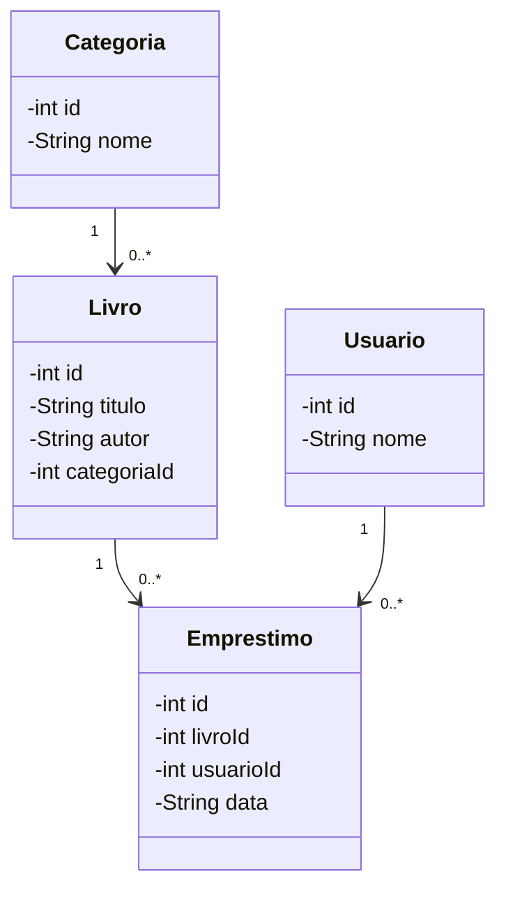
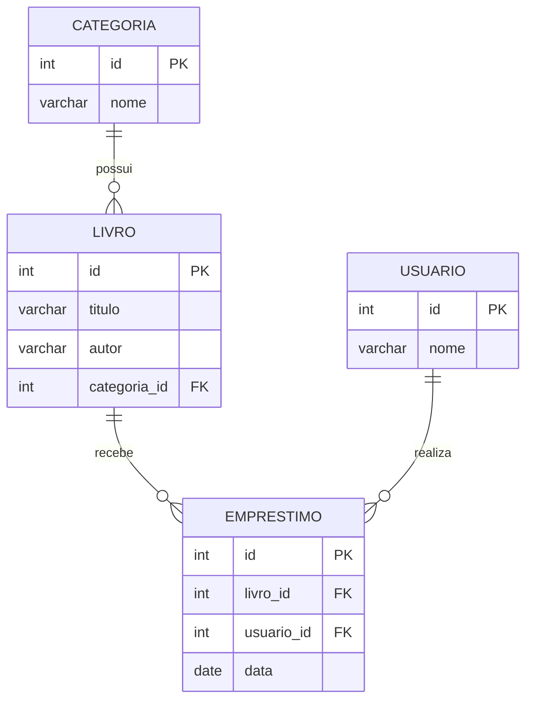

# Sistema de Biblioteca

Trabalho da faculdade de Engenharia de Software. É um sistema desktop de biblioteca feito em Java Swing, com banco SQLite por JDBC.

Os autores são Vinícius da Motta Carvalho Faria, João Pedro Pedroso, Erik Uller e Luis Miguel de Aguida Madureira dos Santos.

## Tema

Gerenciamento de uma biblioteca pequena, com cadastro de categorias, livros, usuários e empréstimos.

## Tecnologias utilizadas

- Java
- Java Swing
- JDBC
- SQLite
- Padrão MVC

## O que o sistema faz

O sistema tem quatro entidades: Categoria, Livro, Usuario e Emprestimo. A tela principal tem um botão para cada uma, e cada botão abre a tela daquela entidade.

Todas as telas funcionam do mesmo jeito. Dá para salvar um registro novo, alterar, excluir e atualizar a tabela que mostra o que está no banco. Para alterar ou excluir, é só clicar na linha da tabela.

Algumas coisas para saber na hora de usar:

- O livro guarda o ID de uma categoria, então a categoria precisa existir antes.
- O empréstimo guarda o ID de um livro, o ID de um usuário e a data no formato AAAA-MM-DD.
- Esses IDs são digitados na mão. Não existe lista para escolher.
- Se um registro estiver ligado a outro (uma categoria com livros, por exemplo), o banco não deixa excluir e o sistema avisa que não foi possível.

## Estrutura MVC

- `model`: classes das entidades.
- `view`: telas feitas com Java Swing.
- `controller`: comunicação entre as telas e o banco de dados.
- `conexao`: classe responsável pela conexão JDBC com o SQLite.

Pastas do projeto:

```text
banco/         script SQL com o banco e as tabelas
diagramas/     diagrama de classes e diagrama MER
prototipos/    protótipos das telas
src/main/java/
    conexao/
    controller/
    model/
    view/
```

## Diagrama de classes



## Diagrama MER



## Protótipos das telas

Os protótipos estão neste arquivo: [Ver protótipos](prototipos/prototipos-telas.md)

## Banco de dados

O banco `biblioteca.db` e as quatro tabelas são criados automaticamente ao usar o sistema. O script também está em `banco/biblioteca.sql`.

## Como executar (SQLite)

1. Instalar Java 21 e o driver [SQLite JDBC](https://github.com/xerial/sqlite-jdbc/releases).
2. Colocar o arquivo `sqlite-jdbc-*.jar` na pasta `lib` e adicioná-lo às bibliotecas Java do VS Code (Classpath > Libraries). Se o driver exigir SLF4J, adicionar também as dependências necessárias.
3. Executar `src/main/java/view/TelaPrincipal.java`.
4. Cadastrar categoria e usuário, depois livro e empréstimo. O arquivo `biblioteca.db` é criado automaticamente.

## Alternativa MySQL

Arquivos em [alternativa-mysql](alternativa-mysql): script SQL e classe de conexão originais.

1. Executar `alternativa-mysql/biblioteca.sql` em um servidor MySQL com acesso autorizado.
2. Copiar `alternativa-mysql/Conexao.java` para `src/main/java/conexao/Conexao.java`, substituindo a versão SQLite.
3. Adicionar o [MySQL Connector/J](https://dev.mysql.com/downloads/connector/j/) às bibliotecas Java do projeto.
4. Ajustar o usuário e a senha da conexão para o seu MySQL, sem publicar credenciais.
5. Executar `view.TelaPrincipal`.

Para voltar ao SQLite, restaurar a classe de conexão SQLite do repositório.
